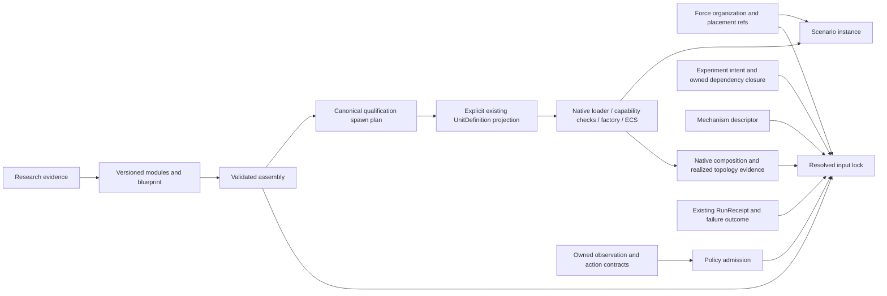

# RFC qualification implementation and remaining acceptance gates

Document kind: `work`
Lifecycle: `active`
Canonical: `docs/architecture/work/issues/rfc_qualified_composition_implementation.md`
Owner: `cross-domain architecture`
Last verified: `2026-10-12`

## Scope and source

This is a local qualification integration on `main@de19c3dbd69e9feb330b1291e84a210c53bfd09f`.
It carries the proposed ADRs and prototypes from PRs #256–#261 into an isolated
worktree. It does not mark the RFCs accepted or enable a production profile.
The continuation also ports the existing #210 owner repair from PR #230,
`7989800d284484c76ccd0aed77cca32300fb2dda`, onto current main interfaces.
Only its failure guards, recovery behavior, bindings and tests were carried;
obsolete command setters and older broadphase code were excluded. Current main's
newer composition diagnostics and resize operation received the same failure guard.

| RFC | Source PR | Source head |
| --- | --- | --- |
| #229 mechanism ports | #256 | `a76c9932ec37d6bca817b34b0ebaae70b9446a64` |
| #236 platform assembly | #257 | `8fdc5302bb526a976b0f5be8c7532e9bb5a65117` |
| #237 force packages | #258 | `1a55dfdc545f394628ac896deb5f0e14c7c28eee` |
| #238 Policy | #259 | `14b96c36c26ca20029bbb391aee2c2c6264160ee` |
| #239 input lock | #260 | `897d29f02b98212e8a4431ae02721f0bcf90a62c` |
| #251 failure domains | #261 | `f8403b3ea13a47796f792053e142b4f6c1b44dbb` |

## Implemented and measured

| RFC | Implemented in this checkpoint | Evidence and limits |
| --- | --- | --- |
| #229 | Complete recursive boundaries; capability/clock/backend inheritance; incompatible information layers, clocks and multiple producers reject. Immutable parameters, backend references and clock policies participate in identity. Two native Air seeker primitive adapters and one stateful CV tracker share a qualification configuration. | Native LOS conversion and world-position reconstruction feed the actual CV tracker. Four timesteps reach the same four-second horizon under a fixed measurement schedule. A child exception after native state mutation but before outer publication reuses #251's unknown-state projection. The live topology order checker still detects a reversed `ClearForces`/`FlightControl` mapping. These are bounded proofs, not installation of an authored execution graph. |
| #236 | Numeric bounds, blueprint constraints, module digests and native reference selections participate in plan identity. An explicit immutable legacy projection returns existing UnitDefinition JSON and rejects missing fields or changed module bindings before loading. The opt-in `platform_blueprint_adapter` now projects a resolved plan to the maintained typed request shape and rejects slot/cardinality, module identity and native capability-family drift before DTO publication. The native validator rejects source, bundle and resolved-capability drift. | F-16 and Ground infantry are lowered, loaded and spawned through existing native owners. All public observation fields match at setup and after four steps. A separate F-16 assembly reaches `RuntimeFacade` through the maintained typed setup and matches `WorldSpawnRequest` at setup and after four steps. Generalized factory-plan comparison, explicit unit contracts and all physical compatibility constraints remain open. |
| #237 | Relationships survive compilation and hashing with instance-scoped endpoints; reused packages expand independently; nested role capability requirements are checked; frame/anchor/provenance references survive in package-instance evidence. A qualification adapter now binds one compiled package to an existing CSG group by explicit entity-name and assembly-type maps, and records CSG schema, scenario, geometry and embarked-inventory digests. | Recursive, CSG adapter and negative fixtures. The adapter rejects binding/side/role/frame drift; CSG still owns coordinate expansion, geodesy, embarked inventory and native scenario materialization. It does not install task authority or replace the CSG compiler. |
| #238 | Field provenance/frame checks, explicit optional defaults with preserved field order, action bounds/timing checks, deterministic policy selection and a legacy-kind compatibility gate. | Basic mission fields come from the mission packet owner, action dimensions from the existing native action adapter, and action bounds from the existing Gym space. Two models created through DecisionModelRegistry retain reset/decide/close and generate identical native PilotAction values. The learned registration uses a deterministic stand-in, not a trained checkpoint. |
| #239 | Deeply immutable canonical input identity, ScenarioCompiler dependency projection, separate observed native manifest/graph/topology identity, and a join to the existing RunReceipt validator. | One existing Air matrix entry produces a static candidate with explicit effective seeds. Stale scenario snapshots reject. Receipt/comparability fixtures are synthetic owner-contract vectors; they are not durable production run records. A string `status=completed` alone cannot establish comparability. |
| #251 | Exact completion coverage and conservative aggregate-fault projection; local #210 native failure fence, guarded exports and explicit reset recovery. Python/facade reuse that owner implementation. | Native 3/4-world serial/parallel mixed-advancement and post-timestep setup faults, invalid recovery input, blocked retry/export and successful reset. No per-world commit, rollback, cancellation or process isolation is established. |

## Single-owner integration map

| Datum | Authority | Qualification consumer |
| --- | --- | --- |
| Primitive model behavior and physical state | Existing native models, SimulationKernel and Flecs | Mechanism descriptor; no new dispatcher |
| Packets, stage barriers and shard ownership | Native contracts and StageNodeManifest | Typed ports; the advisory clock-domain flag remains in force |
| Realized scheduling | Native CPU scheduler topology export (#127) | Order checker and input-lock evidence projection |
| Executable equipment parameters and spawning | UnitDefinition loader, capability validators, DefaultUnitFactory | Explicit blueprint-to-legacy adapter |
| Research factuality and calibration | Research/equipment owners | Evidence references; never automatic admission |
| CSG placement and group expansion | Existing ScenarioCompiler/group_composition | Force-package references and instance evidence |
| Commands, roles and rights | Joint/tasking contracts and Agent binding | Policy/force descriptors cannot grant rights |
| Mission field order and raw units | mission_obs_taxonomy | Basic field catalogue projection |
| Native Air actions / Gym bounds | simulation.air.action / universal_env_parts.spaces | Gated Policy action checks |
| DecisionModel lifecycle and legacy registration | tasking_contracts.common.decision_registry | Explicit compatibility selection |
| Input dependency resolution | Experiment registry and ScenarioCompiler | Immutable resolved input lock |
| Run completion/durability | Existing RunReceipt and ledger owners | Validated referenced receipt; no second ledger |
| Native batch failure/recovery validity | #209/#210 owners | Conservative unknown-state projection |



The Python qualification boundary precedes native publication. Passing it
does not bypass native admission or make research records executable.

## Verification

### Native continuation proof

The shared fixture is
`tests/fixtures/mechanisms/air_perception_qualification.json`. Its native consumers
call `world_los_from_relative_angles`, `world_position_from_los_range` and
`update_world_cv_alpha_beta_tracker`; the second function is the existing
production reconstruction formula extracted into the model-owned math header.
No second implementation of that formula was introduced.

The numerical proof uses measurement epochs 0, 0.5, 1, 1.5 and 2 seconds,
then coasts to 4 seconds with timesteps 0.25, 0.1, 1/30 and 1/60 seconds.
The constant-velocity synthetic belief trajectory and moving observer are fixed
across runs. Position tolerance is `1e-8 m`, velocity tolerance `1e-9 m/s`;
all four runs measured approximately `1.29e-12 m` and `1.14e-13 m/s` error.
This qualifies the stated deterministic geometry/tracker slice, not noisy sensor
calibration or timestep invariance of other models.

The child-fault probe observes two accepted native measurements and changed
tracker state before the injected exception; no outer packet is published.
#251 reports `failed`, unknown commit status and explicit reset/recreate required.
The native batch probe separately shows that one worker chunk can stop while
other chunks finish. The exact-stage trace hook itself opens a Flecs frame;
its clock mutation is captured before the failing batch call, rather than being
attributed to that call. Clock observations remain diagnostics.

Reproduce the native lane after building both existing targets:

```powershell
cmake --build build-rfc-native --config Release --target ef_py ef_test -j 3
$env:CMO_BUILD_DIR = 'build-rfc-native'
python -m pytest tests/architecture/mechanisms/test_air_perception_qualification.py tests/architecture/composition/test_native_failure_qualification.py -q
& build-rfc-native/Release/ef_test.exe --test-suite='world_batch_runtime,world_cv_alpha_beta_tracker,world_cva_alpha_beta_gamma_tracker,air_perception_qualification' --no-colors
```

The Python/native bridge requires the `ef_test` binary; it skips that proof when
the target is absent. This local verification built the target and had no skips
in the 125-test focused run. The JUnit record in
`build-rfc-native/rfc-focused-results.xml` carries the graph digest, executed
test-binary SHA-256 and native numerical/fault evidence. It is a local test record,
not a production RunReceipt or trust attestation.

The native extension was freshly built with MSVC 19.44, x64, Release and
Python 3.12.4 in `build-rfc-native`. Dependency sources were reused read-only
from the existing pinned source trees; this worktree owns its build outputs.
The build reported existing compiler warnings and completed successfully.

Focused verification uses `CMO_BUILD_DIR=build-rfc-native` and the six
prototype modules, six ADR guards, the native RFC integration proof,
`test_air_facade_demo.py`, `test_air_action_adapter.py`, the decision-registry
tests and native composition-evidence tests. The architecture suite manifest
registers the qualification tests. See the final execution result for counts;
this document does not infer other-host or full-repository parity.

Latest local results: **125 focused Python tests passed** and **31 native tests /
842 assertions passed**; **9 suite-manifest tests passed**. Ruff passed on all
25 changed Python surfaces, whitespace checks passed, and **17 touched documents /
116 local links had zero link issues**. The primary checkout retained its original HEAD and
clean status. The owner requested batched commits and pushes of this checkpoint
on `codex/rfc-qualified-composition`. The publication gate repeats the 125-test
focused run and preserves the reviewed file contents across the split.

## Batched branch publication

The eight commits are ordered by their implementation dependencies:

| Batch | Scope | Dependency |
| --- | --- | --- |
| 1 | #210 native failure fence, recovery, bindings, tests and owned contract | current main |
| 2 | #251 conservative failure outcomes and Python/native recovery proof | batch 1 |
| 3 | #229 typed recursive ports and native Air perception qualification | batch 2 |
| 4 | #236 platform assembly and explicit legacy UnitDefinition projection | current main |
| 5 | #237 recursive force-package identity and relationship evidence | current main |
| 6 | #238 Policy contracts and existing observation/action owner projections | current main |
| 7 | #239 immutable input lock and existing receipt/native evidence projections | batch 2 |
| 8 | Cross-RFC proof, suite registration, six proposed ADRs and navigation | batches 1–7 |

Each batch is pushed to the same
[qualification branch](https://github.com/Void0312Aurora/Echelon-Forge/tree/codex/rfc-qualified-composition)
and its remote head is compared with the local commit. The final committed tree
is compared with the complete pre-split snapshot. This publication is a reviewable
implementation checkpoint; it does not update the original RFC PR branches,
merge into main, accept the proposed ADRs or close RFC issues.

## Remaining work, in dependency order

1. **Owner review of the six proposed designs.** Choose the admission schema,
   version rules and capability vocabulary before enabling production consumers.
2. **#229 native admission mapping.** The bounded adapter/numerical/child-fault
   proof is now present. Unknown schemas, shard conflicts and freshness still need
   owner-supplied vocabulary and enforced native admission, beyond exact nominal
   port matching. Compile reviewed descriptors into existing native contracts and
   qualify their publication/realized scheduling without a second dispatcher.
3. **#236 native typed plan seam.** The bounded adapter and native identity
   checks now cover slot cardinality, module digest/native-reference identity,
   maintained capability families and an Air parity path. Owner review is still
   required for explicit unit contracts, direct comparison with the
   factory-resolved capability plan and broader physical compatibility before
   any production consumer is enabled.
4. **#237 CSG migration proof.** Consume compiled organization through the
   existing CSG/scenario placement adapter; compare generated entities, anchored
   geometry, embarked inventory and native results. Keep separate membership,
   command and communication graphs.
5. **#238 owner-controlled binding.** Carry field/default/action contract
   identities into the actual agent binding and experiment evidence; qualify
   the full selected observation view and a real external model/checkpoint.
   Preserve existing legacy runtime/report consumers until migration is accepted.
6. **#239 host evidence join.** Have the existing host bind the input-lock
   digest into its actual RunReceipt inputs, verify durable completion and join
   publication evidence. The current proof validates a schema, not signatures
   or durable availability.
7. **#251 remaining fault gates.** The existing #210 lineage is locally ported and
   verified; upstream main still lacks it. Preserve its owner during review and
   delivery. The completed setup/worker proofs do not cover an exception inside a
   running native system, native-issued generation IDs, worker-launch failure
   observed through a full batch instance, or bounded fatal/nontermination controls.
   Add those probes through existing test owners and subprocess/supervisor paths;
   no transparent retry or per-world commit claim follows from current evidence.

## 2026-10-12 native typed-plan continuation

The continuation added `python/content/platform_blueprint_adapter.py`, a
content-side bridge that emits the existing expanded typed-request tree without
importing `ef_py`. The existing bindings adapter then constructs the native DTO.
The bridge revalidates schema/family/plan identity, reuses the maintained
capability-family vocabulary, and binds a full legacy `UnitDefinition` snapshot
digest into the request identity. A plan whose lowering would change that
snapshot is rejected; parameterized variants remain on the existing legacy
lowering/loader path. Native request validation now checks source identity,
bundle identity and capability records by unique capability ID before admission,
while rejected plans retain their specific rejection reason.

The current continuation passed **67 content/composition/binding/rollback and
manifest tests**, **35 platform-spawn architecture tests**, and Ruff on all
changed Python files. After rebuilding both native targets, the selected native
suites passed **31 cases / 842 assertions**. The prior four standalone MSVC
factory-header failures were repaired by including the owning `SimObject` tag
header directly. A bounded F-16 fuel override is lowered to legacy JSON, loaded
by the existing native loader and produces a motion difference after one step;
initial public observations omit fuel mass. The typed Air proof remains a
qualification fixture: it uses an
existing F-16 native type and does not compare arbitrary authoring fields with
the factory's internally derived capability bundle. Units and broader physical
compatibility remain owner-review gates.

The #237 CSG adapter adds **18 force-package/adapter tests**. It requires an
explicit compiled-scenario input and explicit organization-to-entity and
assembly-to-native-type bindings; it does not infer those mappings from the
CSG domain schema.

The qualification modules, catalogue helpers, tests and proposed documents remain
opt-in. Configuration formats, native scheduling, production profiles and
DecisionModel registrations are unchanged. The native #210 port intentionally
changes post-exception retry/export behavior to fail-closed; healthy default Air
paths retain the measured parity. Reverting that owner repair is separate from
removing the qualification frontend. Branch publication does not imply delivery
to main, production admission or RFC issue closure.
