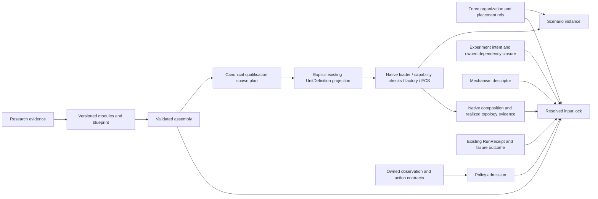

# RFC qualification implementation and remaining acceptance gates

Document kind: `work`
Lifecycle: `active`
Canonical: `docs/architecture/work/issues/rfc_qualified_composition_implementation.md`
Owner: `cross-domain architecture`
Last verified: `2026-10-12`

## Scope and source

This is a local qualification integration on the branch point
`main@de19c3dbd69e9feb330b1291e84a210c53bfd09f` (the current upstream `main` has
advanced independently).
It carries the proposed ADRs and prototypes from PRs #256–#261 into an isolated
worktree. It does not mark the RFCs accepted or enable a production profile.
The continuation also ports the existing #210 owner repair from PR #230,
`7989800d284484c76ccd0aed77cca32300fb2dda`, onto the branch-point interfaces.
Only its failure guards, recovery behavior, bindings and tests were carried;
obsolete command setters and older broadphase code were excluded. The branch-point
composition diagnostics and resize operation received the same failure guard.

| RFC | Source PR | Source head |
| --- | --- | --- |
| #229 mechanism ports | #256 | `a76c9932ec37d6bca817b34b0ebaae70b9446a64` |
| #236 platform assembly | #257 | `8fdc5302bb526a976b0f5be8c7532e9bb5a65117` |
| #237 force packages | #258 | `1a55dfdc545f394628ac896deb5f0e14c7c28eee` |
| #238 Policy | #259 | `14b96c36c26ca20029bbb391aee2c2c6264160ee` |
| #239 input lock | #260 | `897d29f02b98212e8a4431ae02721f0bcf90a62c` |
| #251 failure domains | #261 | `f8403b3ea13a47796f792053e142b4f6c1b44dbb` |

## Implemented and measured

| RFC | Implemented in this checkpoint | Evidence and limits |
| --- | --- | --- |
| #229 | Complete recursive boundaries; capability/clock/backend inheritance; incompatible information layers, clocks and multiple producers reject. Immutable parameters, backend references and clock policies participate in identity. Two native Air seeker primitive adapters and one stateful CV tracker share a qualification configuration. A bounded adapter now binds compiled nodes to an owner-provided StageNodeManifest snapshot and reuses realized-order evidence. | Native LOS conversion and world-position reconstruction feed the actual CV tracker. Four timesteps reach the same four-second horizon under a fixed measurement schedule. Missing, duplicate, incomplete or adapter-only stage evidence rejects before qualification. A child exception after native state mutation but before outer publication reuses #251's unknown-state projection. These are bounded proofs, not installation of an authored execution graph. |
| #236 | Numeric bounds, blueprint constraints, module digests and native reference selections participate in plan identity. Bounded mass, power-budget and slot-mount compatibility checks now fail closed before publication. Explicit hardpoint contracts and loadout selections validate mount class, allowed module kind, quantity, capacity, module physical metadata and native identity before publication; all of those values participate in the canonical plan identity. The immutable legacy projection now requires an explicit loadout path and rejects missing or mismatched loadout evidence instead of silently dropping selected modules. The opt-in `platform_blueprint_adapter` still projects a resolved plan to the maintained typed request shape, rejects slot/cardinality, module identity and native capability-family drift before DTO publication, and can compare shared source type/capability semantics with a factory-resolved plan. The native validator rejects source, bundle and resolved-capability drift. | F-16 and Ground infantry are lowered, loaded and spawned through existing native owners. All public observation fields match at setup and after four steps. A separate F-16 assembly reaches `RuntimeFacade` through the maintained typed setup and matches `WorldSpawnRequest` at setup and after four steps. Hardpoint/loadout qualification is covered by focused validation and projection tests; broader native unit compatibility and owner production review remain open. |
| #237 | Relationships survive compilation and hashing with instance-scoped endpoints; reused packages expand independently; nested role capability requirements are checked; frame/anchor/provenance references survive in package-instance evidence. A qualification adapter now binds one compiled package to an existing CSG group by explicit entity-name and assembly-type maps, records CSG schema, scenario, geometry and embarked-inventory digests, and delegates the complete qualified snapshot to the existing loader. | Recursive, full named/mirror CSG, loader and negative fixtures. Both full S0 fixtures bind all seven surface hulls per group; native loader positions and 241 replay frames match. In-memory coordinate, inventory, geometry and runtime-metadata drift is rejected before loading. CSG still owns coordinate expansion, geodesy, embarked inventory and native scenario materialization. It does not install task authority or replace the CSG compiler. |
| #238 | Field provenance/frame checks, explicit optional defaults with preserved field order, action bounds/timing checks, deterministic policy selection, a legacy-kind compatibility gate and an admitted binding through `DecisionRuntimeAgent`. An owner-issued `PolicyCheckpoint` metadata contract now checks artifact digest, policy/version and observation/action contract identity before binding. Verified checkpoint bytes can now pass through an explicit owner-loader seam; the contract layer verifies the digest and model lifecycle protocol without deserializing a framework or creating an action endpoint. | Basic mission fields come from the mission packet owner, action dimensions from the existing native action adapter, and action bounds from the existing Gym space. The binding preserves the existing model reset/decide/close lifecycle, carries verified checkpoint provenance when supplied, and validates the produced action before returning it. Focused tests cover digest rejection before owner loading and owner protocol rejection. A real external checkpoint/model loader, full selected observation view and native action endpoint remain open. |
| #239 | Deeply immutable canonical input identity, semantic freshness checks on compiled scenario snapshots, ScenarioCompiler dependency projection, separate observed native manifest/graph/topology identity, and a host receipt binding join to the existing RunReceipt validator. | One existing Air matrix entry produces a static candidate with explicit effective seeds. Source changes and in-memory semantic snapshot changes reject. The join preserves receipt/run/host/generation, backend graph, native validator evidence and durable acknowledgement, while receipt/comparability fixtures remain synthetic owner-contract vectors rather than durable production run records. A string `status=completed` alone cannot establish comparability. |
| #251 | Exact completion coverage and conservative aggregate-fault projection; local #210 native failure fence, guarded exports and explicit reset recovery. The Python projection now reads native `batch_healthy()`/`batch_failure_reason()` before emitting all-unknown outcomes. `WorldBatchRuntime` now issues a native-owned batch generation ID that changes only after successful reset. A host-fault projection accepts an independent process-survival observation and terminates the generation without inventing per-world commit state. Actual 3/4-world launch-failure injection remains private to native test access. | Native 3/4-world serial/parallel mixed-advancement, post-timestep setup faults and first/later worker-launch failures, invalid recovery input, blocked retry/export and successful reset. The state matrix distinguishes `healthy`, `failed/untrusted` and reset-created `healthy`; generation identity is native-owned, while per-world commit, rollback, cancellation, a real supervisor/process-isolation path and fatal/nontermination bounds remain unestablished. Upstream `main` has not received this local #210 port. |

## Single-owner integration map

| Datum | Authority | Qualification consumer |
| --- | --- | --- |
| Primitive model behavior and physical state | Existing native models, SimulationKernel and Flecs | Mechanism descriptor; no new dispatcher |
| Packets, stage barriers and shard ownership | Native contracts and StageNodeManifest | Typed ports; the advisory clock-domain flag remains in force |
| Realized scheduling | Native CPU scheduler topology export (#127) | Order checker and input-lock evidence projection |
| Executable equipment parameters and spawning | UnitDefinition loader, capability validators, DefaultUnitFactory | Explicit blueprint-to-legacy adapter |
| Research factuality and calibration | Research/equipment owners | Evidence references; never automatic admission |
| CSG placement and group expansion | Existing ScenarioCompiler/group_composition | Force-package references and instance evidence |
| Commands, roles and rights | Joint/tasking contracts and Agent binding | Policy/force descriptors cannot grant rights |
| Mission field order and raw units | mission_obs_taxonomy | Basic field catalogue projection |
| Native Air actions / Gym bounds | simulation.air.action / universal_env_parts.spaces | Gated Policy action checks |
| DecisionModel lifecycle and legacy registration | tasking_contracts.common.decision_registry | Explicit compatibility selection |
| Input dependency resolution | Experiment registry and ScenarioCompiler | Immutable resolved input lock |
| Run completion/durability | Existing RunReceipt and ledger owners | Validated referenced receipt; no second ledger |
| Native batch failure/recovery validity | #209/#210 owners | Conservative unknown-state projection |



The Python qualification boundary precedes native publication. Passing it
does not bypass native admission or make research records executable.

## Verification

### Native continuation proof

The shared fixture is
`tests/fixtures/mechanisms/air_perception_qualification.json`. Its native consumers
call `world_los_from_relative_angles`, `world_position_from_los_range` and
`update_world_cv_alpha_beta_tracker`; the second function is the existing
production reconstruction formula extracted into the model-owned math header.
No second implementation of that formula was introduced.

The numerical proof uses measurement epochs 0, 0.5, 1, 1.5 and 2 seconds,
then coasts to 4 seconds with timesteps 0.25, 0.1, 1/30 and 1/60 seconds.
The constant-velocity synthetic belief trajectory and moving observer are fixed
across runs. Position tolerance is `1e-8 m`, velocity tolerance `1e-9 m/s`;
all four runs measured approximately `1.29e-12 m` and `1.14e-13 m/s` error.
This qualifies the stated deterministic geometry/tracker slice, not noisy sensor
calibration or timestep invariance of other models.

The child-fault probe observes two accepted native measurements and changed
tracker state before the injected exception; no outer packet is published.
#251 reports `failed`, unknown commit status and explicit reset/recreate required.
The native batch probe separately shows that one worker chunk can stop while
other chunks finish. The exact-stage trace hook itself opens a Flecs frame;
its clock mutation is captured before the failing batch call, rather than being
attributed to that call. Clock observations remain diagnostics.

Reproduce the native lane after building both existing targets:

```powershell
cmake --build build-rfc-native --config Release --target ef_py ef_test -j 3
$env:CMO_BUILD_DIR = 'build-rfc-native'
python -m pytest tests/architecture/mechanisms/test_air_perception_qualification.py tests/architecture/composition/test_native_failure_qualification.py -q
& build-rfc-native/Release/ef_test.exe --test-suite='world_batch_runtime,world_cv_alpha_beta_tracker,world_cva_alpha_beta_gamma_tracker,air_perception_qualification' --no-colors
```

The Python/native bridge requires the `ef_test` binary; it skips that proof when
the target is absent. This local verification built the target and had no skips
in the 125-test focused run. The JUnit record in
`build-rfc-native/rfc-focused-results.xml` carries the graph digest, executed
test-binary SHA-256 and native numerical/fault evidence. It is a local test record,
not a production RunReceipt or trust attestation.

The native extension was freshly built with MSVC 19.44, x64, Release and
Python 3.12.4 in `build-rfc-native`. Dependency sources were reused read-only
from the existing pinned source trees; this worktree owns its build outputs.
The build reported existing compiler warnings and completed successfully.

Focused verification uses `CMO_BUILD_DIR=build-rfc-native` and the six
prototype modules, six ADR guards, the native RFC integration proof,
`test_air_facade_demo.py`, `test_air_action_adapter.py`, the decision-registry
tests and native composition-evidence tests. The architecture suite manifest
registers the qualification tests. See the final execution result for counts;
this document does not infer other-host or full-repository parity.

Prior checkpoint local results: **125 focused Python tests passed** and **31 native tests /
842 assertions passed**; **9 suite-manifest tests passed**. Ruff passed on all
25 changed Python surfaces, whitespace checks passed, and **17 touched documents /
116 local links had zero link issues**. The primary checkout retained its original HEAD and
clean status. The owner requested batched commits and pushes of this checkpoint
on `codex/rfc-qualified-composition`. The publication gate repeats the 125-test
focused run and preserves the reviewed file contents across the split.

## Batched branch publication

The eight commits are ordered by their implementation dependencies:

| Batch | Scope | Dependency |
| --- | --- | --- |
| 1 | #210 native failure fence, recovery, bindings, tests and owned contract | current main |
| 2 | #251 conservative failure outcomes and Python/native recovery proof | batch 1 |
| 3 | #229 typed recursive ports and native Air perception qualification | batch 2 |
| 4 | #236 platform assembly and explicit legacy UnitDefinition projection | current main |
| 5 | #237 recursive force-package identity and relationship evidence | current main |
| 6 | #238 Policy contracts and existing observation/action owner projections | current main |
| 7 | #239 immutable input lock and existing receipt/native evidence projections | batch 2 |
| 8 | Cross-RFC proof, suite registration, six proposed ADRs and navigation | batches 1–7 |

Each batch is pushed to the same
[qualification branch](https://github.com/Void0312Aurora/Echelon-Forge/tree/codex/rfc-qualified-composition)
and its remote head is compared with the local commit. The final committed tree
is compared with the complete pre-split snapshot. This publication is a reviewable
implementation checkpoint; it does not update the original RFC PR branches,
merge into main, accept the proposed ADRs or close RFC issues.

## Remaining work, in dependency order

1. **Owner review of the six proposed designs.** Choose the admission schema,
   version rules and capability vocabulary before enabling production consumers.
2. **#229 native admission mapping.** The bounded adapter/numerical/child-fault
   proof is now present. The qualification compiler now accepts an owner-supplied
   schema vocabulary, rejects unknown port schemas, carries freshness through edge
   and composite identity checks, and has a strict StageNodeManifest admission
   mode for required native contract fields and duplicate state-shard writers.
   The native owner now exposes a read-only maintained `StageNodeManifest`
   snapshot through `WorldBatchRuntime` for qualification diagnostics. The
   bounded Air lane now enforces an explicit, versioned six-schema owner
   vocabulary. Each entry names one of its three maintained native
   implementations, and the vocabulary digest is included in graph identity.
   A deterministic qualification projection now emits one immutable
   authored-node-to-owner-contract record per binding, plus graph, manifest
   registry and edge identity digests. It accepts the native snapshot object
   shape directly, while treating any optional realized-system name as
   supplemental evidence. The projection is explicitly non-executable and
   rejects invalid, duplicate, adapter-only or diagnostics-only bindings.
   Owner vocabularies can now be merged into a versioned qualification
   registry; repeated entries are coalesced only when their owner is identical,
   and conflicting owner claims fail closed. This is a reusable registry seam,
   not a claim that the repository-wide canonical packet vocabulary is complete.
   Repository-wide canonical schema vocabulary and compilation of an authored
   graph into executable native contracts remain open; no second dispatcher is
   introduced.
3. **#236 native typed plan seam.** The bounded adapter and native identity
   checks now cover slot cardinality, module digest/native-reference identity,
   maintained capability families, an Air parity path and an optional comparison
   against a factory-resolved source type/capability-semantics snapshot. The
   native `DefaultUnitFactory` now exposes that resolved plan through a read-only
   `WorldBatchRuntime` query, preserving the factory as the only materialization
   owner. The qualification bridge now uses an explicit, versioned
   authored-key to native-family mapping and includes its digest in the typed
   request identity; a supplied factory plan still decides admission. Explicit
   hardpoint contracts and loadout selections now validate mount class, allowed
   kind, quantity, capacity, physical metadata and native identity, and legacy
   lowering requires a declared loadout path. Owner review is still required
   for the mapping's production contract, explicit unit contracts and broader
   native physical compatibility before any production consumer is enabled.
4. **#237 CSG migration proof.** Consume compiled organization through the
   existing CSG/scenario placement adapter; compare generated entities, anchored
   geometry, embarked inventory and native results. Keep separate membership,
   command and communication graphs.
5. **#238 owner-controlled binding.** The admitted binding now wraps the
   existing `DecisionRuntimeAgent`, carries policy/version and observation
   provenance into the model context, and validates produced actions before
   returning them. An owner-issued checkpoint metadata contract now binds the
   artifact digest and observation/action versions before binding. Qualify the
   full selected observation view, native action endpoint and a real external
   model/checkpoint. The checkpoint seam now verifies artifact bytes before
   handing them to an owner-provided loader; the loader remains responsible
   for framework deserialization. Preserve existing legacy runtime/report
   consumers until migration is accepted.
6. **#239 host evidence join.** Have the existing host bind the input-lock
   digest into its actual RunReceipt inputs, verify durable completion and join
   publication evidence. The qualification join now preserves receipt/run/
   attempt/host/generation identity, backend system-graph digest, native
   validator evidence digest and durable acknowledgement, and rejects a
   supplied nested or top-level native receipt binding that disagrees. The
   current proof still uses a synthetic receipt vector and does not establish
   signatures or durable availability from a live host.
7. **#251 remaining fault gates.** The existing #210 lineage is locally ported and
   verified against this branch's interface baseline; upstream main still lacks it.
   Preserve its owner during review and
   delivery. The native `WorldBatchRuntime` proof now injects a worker-launch
   failure through a private test accessor, verifies joined workers,
   failed-generation export fencing, failed recovery fencing, native-owned
   generation IDs and explicit reset recovery. The remaining gaps are an
   exception inside a running native system and bounded fatal/nontermination
   controls. Add those probes through
   existing test owners and subprocess/supervisor paths; no transparent retry or
   per-world commit claim follows from current evidence.

## 2026-10-12 native typed-plan continuation

The continuation added `python/content/platform_blueprint_adapter.py`, a
content-side bridge that emits the existing expanded typed-request tree without
importing `ef_py`. The existing bindings adapter then constructs the native DTO.
The bridge revalidates schema/family/plan identity, reuses the maintained
capability-family vocabulary, and binds a full legacy `UnitDefinition` snapshot
digest into the request identity. A plan whose lowering would change that
snapshot is rejected; parameterized variants remain on the existing legacy
lowering/loader path. Native request validation now checks source identity,
bundle identity and capability records by unique capability ID before admission,
while rejected plans retain their specific rejection reason.

The current continuation passed the new **92-test typed-platform/input-lock
regression subset**, plus **229 scenario tests with 23 subtests** after the
compiler and CSG changes. Ruff, whitespace checks and focused existing native
tests remain required gates. The current native rerun passed **32 cases / 938 assertions**;
the prior continuation passed **67 content/composition/binding/rollback and
manifest tests**, **35 platform-spawn architecture tests**, and Ruff on all
changed Python files. After rebuilding both native targets, the selected native
suites passed **31 cases / 842 assertions**. The prior four standalone MSVC
factory-header failures were repaired by including the owning `SimObject` tag
header directly. A bounded F-16 fuel override is lowered to legacy JSON, loaded
by the existing native loader and produces a motion difference after one step;
initial public observations omit fuel mass. The typed Air proof remains a
qualification fixture: it uses an
existing F-16 native type and does not compare arbitrary authoring fields with
the factory's internally derived capability bundle. Units and broader physical
compatibility remain owner-review gates.

The native factory/stage-owner continuation rebuilt `ef_py` and `ef_test` in
the isolated `build-rfc-native` tree. The `world_batch_runtime` suite passed
**22 cases / 480 assertions**. The combined Python binding, mechanism,
composition and platform-adapter regression subset passed **58 tests**. The
factory query is read-only: it returns
the factory's resolved plan for a type name, preserves the source type
projection, rejects unknown types with the native reason, and leaves the batch
healthy. This exposes the owner result for diagnostics; it does not yet make
authored blueprint capability keys or hardpoint/loadout fields equivalent to
that result.

The same native continuation exposes the maintained scheduler manifest registry
as a read-only `WorldBatchRuntime` snapshot. Native validation confirms the
returned copy contains the three maintained scheduler stages and excludes the
adapter and diagnostics-only projections; the Python binding sees the same
owner fields. This is an owner-publication diagnostic seam, not a canonical
schema vocabulary or authored-graph admission path.

The #237 CSG adapter now has **14 force-package/adapter tests**, including two
full S0 fixture runs. It requires an explicit compiled-scenario input and
explicit organization-to-entity and assembly-to-native-type bindings; it does
not infer those mappings from the CSG domain schema. `load_qualified_csg_scenario`
only delegates a fresh, fully qualified snapshot to `ScenarioLoader`; it does
not synthesize entities or grant command authority.

The physical compatibility slice for #236 is bounded and fail-closed. A
blueprint may declare finite mass and power budgets plus slot mount classes;
constrained assemblies require those module fields, use deterministic sorted
`math.fsum` totals, and bind the physical tuple into plan identity. Explicit
hardpoint contracts and loadout selections additionally bind mount class,
allowed kind, quantity, capacity, module digest/native reference and physical
parameters into the plan identity. Missing loadout physical metadata, capacity
overflow, incompatible mount/kind selections and undeclared legacy loadout
paths reject before projection. Legacy unconstrained modules remain valid with
unknown physical values. The native factory projection seam is now covered by
native and Python binding tests, but the adapter comparison still fails closed
unless the supplied native plan is admitted and its capability family, type,
implementation reference and required/supported flags match. The bridge binds a
versioned canonical authored-key to native-family mapping, records its digest in
the typed request identity and rejects unknown keys before DTO publication.
This remains a qualification mapping until the native owner reviews its
production contract; broader unit compatibility remains open.

The qualification modules, catalogue helpers, tests and proposed documents remain
opt-in. Configuration formats, native scheduling, production profiles and
DecisionModel registrations are unchanged. The native #210 port intentionally
changes post-exception retry/export behavior to fail-closed; healthy default Air
paths retain the measured parity. Reverting that owner repair is separate from
removing the qualification frontend. Branch publication does not imply delivery
to main, production admission or RFC issue closure.
