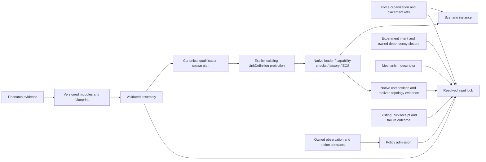

# RFC qualification implementation and remaining acceptance gates

Document kind: `work`
Lifecycle: `active`
Canonical: `docs/architecture/work/issues/rfc_qualified_composition_implementation.md`
Owner: `cross-domain architecture`
Last verified: `2026-10-15`

## Scope and source

This qualification integration began at the historical branch point
`main@de19c3dbd69e9feb330b1291e84a210c53bfd09f`; the maintained upstream
baseline is now `main@ed9e476be4b57831001e0ef8e42d500989933e0e` after the final
RFC stack merge `#287`.
It carries the proposed ADRs and prototypes from PRs #256–#261 into an isolated
worktree. It does not mark the RFCs accepted or enable a production profile.
The continuation historically ported the existing #210 owner repair from PR #230,
`7989800d284484c76ccd0aed77cca32300fb2dda`, onto the branch-point interfaces.
Only its failure guards, recovery behavior, bindings and tests were carried;
obsolete command setters and older broadphase code were excluded. The branch-point
composition diagnostics and resize operation received the same failure guard.

| RFC | Source PR | Source head |
| --- | --- | --- |
| #229 mechanism ports | #256 | `a76c9932ec37d6bca817b34b0ebaae70b9446a64` |
| #236 platform assembly | #257 | `8fdc5302bb526a976b0f5be8c7532e9bb5a65117` |
| #237 force packages | #258 | `1a55dfdc545f394628ac896deb5f0e14c7c28eee` |
| #238 Policy | #259 | `14b96c36c26ca20029bbb391aee2c2c6264160ee` |
| #239 input lock | #260 | `897d29f02b98212e8a4431ae02721f0bcf90a62c` |
| #251 failure domains | #261 | `f8403b3ea13a47796f792053e142b4f6c1b44dbb` |

## Current integration status (2026-10-15)

PRs #278–#287 merged the qualification stack into `main`; the final stack
commit is `ed9e476be4b57831001e0ef8e42d500989933e0e`. The #210 native owner
repair is therefore integrated and is no longer branch-only. The six proposed
ADRs remain `Lifecycle: proposed`, and qualification evidence remains bounded
and opt-in. This document does not claim production profile admission,
per-world commit truth, rollback, transactional semantics or supervisor
isolation.

## Implemented and measured

| RFC | Implemented in this checkpoint | Evidence and limits |
| --- | --- | --- |
| #229 | Complete recursive boundaries; capability/clock/backend inheritance; incompatible information layers, clocks and multiple producers reject. Immutable parameters, backend references and clock policies participate in identity. Two native Air seeker primitive adapters and one stateful CV tracker share a qualification configuration. A bounded adapter now binds compiled nodes to an owner-provided StageNodeManifest snapshot and reuses realized-order evidence. Versioned owner vocabularies now cover both port schemas and freshness labels, and freshness vocabulary identity participates in graph identity. | Native LOS conversion and world-position reconstruction feed the actual CV tracker. Four timesteps reach the same four-second horizon under a fixed measurement schedule. Missing, duplicate, incomplete or adapter-only stage evidence rejects before qualification. A child exception after native state mutation but before outer publication reuses #251's unknown-state projection. These are bounded proofs, not installation of an authored execution graph. |
| #236 | Numeric bounds, blueprint constraints, module digests and native reference selections participate in plan identity. Bounded mass, power-budget and slot-mount compatibility checks now fail closed before publication. Explicit hardpoint contracts and loadout selections validate mount class, allowed module kind, quantity, capacity, module physical metadata and native identity before publication; all of those values participate in the canonical plan identity. The immutable legacy projection now requires an explicit loadout path and rejects missing or mismatched loadout evidence instead of silently dropping selected modules. Because the maintained native `UnitDefinition::default_loadout` map stores one weapon reference per station, native lowering and the typed adapter reject `quantity != 1` until an owner multi-store contract exists; quantity remains qualification evidence and identity. The opt-in `platform_blueprint_adapter` projects slot and supported single-store loadout capabilities into the maintained typed request shape, carries hardpoint and quantity evidence, rejects slot/cardinality, module identity and native capability-family drift before DTO publication, and compares shared source type/capability semantics against an actual native factory-resolved plan. The native validator rejects source, bundle and resolved-capability drift. | F-16 and Ground infantry are lowered, loaded and spawned through existing native owners. An explicit F-16 two-station loadout projection reaches the existing native loader with observation parity after one step. The real database-backed F-16 factory plan is queried; a partial authored capability mapping is rejected before typed DTO publication instead of being treated as equivalent. All public observation fields match at setup and after four steps for the existing F-16/Ground and typed Air proofs. Hardpoint/loadout validation, quantity rejection, legacy projection, native capability projection and factory-plan mismatch fencing are covered by focused tests; broader owner-approved capability mapping, native unit compatibility, multi-store native representation and owner production review remain open. |
| #237 | Relationships survive compilation and hashing with instance-scoped endpoints; reused packages expand independently; nested role capability requirements are checked; frame/anchor/provenance references survive in package-instance evidence. A qualification adapter now binds one compiled package to an existing CSG group by explicit entity-name and assembly-type maps, carries the compiled relationship digest, records CSG schema, scenario, geometry and embarked-inventory digests, and delegates the complete qualified snapshot to the existing loader. The loader requires an independently supplied compiled-package scope and rechecks package and relationship identity before delegation. Malformed group metadata and missing guide-frame evidence now fail closed with explicit qualification errors. | Recursive, full named/mirror CSG, loader and negative fixtures. Both full S0 fixtures bind all seven surface hulls per group; native loader positions and 241 replay frames match. In-memory coordinate, inventory, geometry, runtime-metadata, compiled-package and relationship drift is rejected before loading. CSG still owns coordinate expansion, geodesy, embarked inventory and native scenario materialization. It does not install task authority or replace the CSG compiler. |
| #238 | Field provenance/frame checks, explicit optional defaults with preserved field order, action bounds/timing checks, deterministic policy selection, a legacy-kind compatibility gate and an admitted binding through `DecisionRuntimeAgent`. An owner-issued `PolicyCheckpoint` metadata contract now checks artifact digest, policy/version and observation/action contract identity before binding. Verified checkpoint bytes can now pass through an explicit owner-loader seam, and `PolicyRuntimeBinding.from_checkpoint_artifact` verifies bytes before constructing the existing binding; the contract layer verifies the model lifecycle protocol without deserializing a framework. Runtime binding now rejects a caller-constructed admitted DTO and accepts only the marker produced by `admit_policy()`. The marker is field-bound, so resealing a rejected admission with `dataclasses.replace()` cannot turn it into an admitted binding. The binding supports an owner action-authorizer after generic value/timing checks and before the owner action projector, so current mask, authority and expiry remain native/domain-owner decisions. Admission can consume the maintained owner `ObservationViewSpec`, fail closed on invalid identity/schema/layers, compare the selected view against the policy contract, and carry the admitted view identity/version into the existing model context. | Basic mission fields come from the mission packet owner, action dimensions from the existing native action adapter, and action bounds from the existing Gym space. The binding preserves the existing model reset/decide/close lifecycle, carries verified checkpoint provenance when supplied, validates produced actions and delegates live authorization plus final action projection to owner callbacks. Focused tests cover digest rejection before owner loading, owner protocol rejection, binding-factory loading, action projection, maintained-view binding/provenance, direct and resealed caller-constructed admission rejection and a real `DecisionRuntimeAgent` path that rejects an expired action before projection. An external JSON stand-in checkpoint now runs through PolicyRuntimeBinding and DecisionRuntimeAgent into the existing native facade action endpoint; live native mission updates change model output and observed throttle with direct-action state parity. Production checkpoint quality, selection/profile admission and authorization-provider wiring remain open. |
| #239 | Deeply immutable canonical input identity, semantic freshness checks on compiled scenario snapshots, ScenarioCompiler dependency projection, separate observed native manifest/graph/topology identity, and a host receipt binding join to the existing RunReceipt validator. A file-bound join now reads a host-published canonical receipt, verifies its bytes and delegates to the same owner validator without synthesizing a receipt. Completed comparison now requires the exact structural evidence shape emitted by that join, including a completed outcome, receipt digest/binding and durable acknowledgement. The comparator also checks receipt binding identity fields and digest-shaped native evidence before treating completion evidence as comparable. | One existing Air matrix entry produces a static candidate with explicit effective seeds. Source changes and in-memory semantic snapshot changes reject. The join preserves receipt/run/host/generation, backend graph, native validator evidence and durable acknowledgement, and the file-bound path rejects noncanonical or unreadable host output. Receipt/comparability fixtures remain synthetic owner-contract vectors rather than durable production run records. A bounded native dark-host subprocess now publishes an actual receipt referencing the Air input lock and reopens it through the native file ledger. It checks admission with a missing lock blob, source drift and later blob loss. This reference-only run explicitly reports unexecuted input-lock semantics and remains incomparable; matching host mode and owner-observed semantic execution are required for ordinary comparisons. An opt-in native shutdown capture now persists the same-run CPU scheduler topology as a receipt-bound output artifact; ledger reopening and the file-bound join reject missing, corrupted or mismatched topology evidence. A separate opt-in native world-scope artifact binds outcome indexes to receipt world IDs, boot, incarnation and world epoch. Missing associations remain unknown; file-bound associations require matching receipt-referenced bytes. A string `status=completed` or arbitrary truthy evidence cannot establish comparability. |
| #251 | Exact completion coverage and conservative aggregate-fault projection; local #210 native failure fence, guarded exports and explicit reset recovery. The maintained `RuntimeFacade` now exposes one immutable native-owned `batch_failure_status()` snapshot; the CPU backend projects the exact `WorldBatchRuntime` fields, candidate backends report only their own bounded facts, and Python prefers the snapshot while retaining raw-runtime getter compatibility. The projection binds the supplied generation reference to native generation before emitting all-unknown outcomes. Direct execution outcomes also require an explicit expected-world scope, so failed or partial records cannot omit the affected batch. `WorldBatchRuntime` now issues a native-owned batch generation ID that changes only after successful reset. A host-fault projection accepts an independent process-survival observation and terminates the generation without inventing per-world commit state. Actual 3/4-world launch-failure injection remains private to native test access. A test-only native subprocess now injects a running Flecs callback fault after ECS mutation; unfinished readonly/defer scopes reject reset and raw step, and native `batch_requires_host_recreate()` projects terminal recovery into Python. | Native 3/4-world serial/parallel mixed-advancement, post-timestep setup faults and first/later worker-launch failures, invalid recovery input, blocked retry/export and successful reset. The state matrix distinguishes `healthy`, `failed/untrusted` and reset-created `healthy`; generation identity is checked against the native owner, while per-world commit, rollback and cancellation remain unestablished. Running-system exceptions, process-fatal abort and nontermination now have bounded local subprocess controls with verified replacement-process startup; production supervisor isolation and availability remain unestablished. The #210 owner repair is integrated on `main` via PR #278; the proposed #251 contract and stronger supervisor, per-world and rollback gates remain open. |
| #251 | Exact completion coverage and conservative aggregate-fault projection; local #210 native failure fence, guarded exports and explicit reset recovery. The maintained `RuntimeFacade` now exposes one immutable native-owned `batch_failure_status()` snapshot; the CPU backend projects the exact `WorldBatchRuntime` fields, candidate backends report only their own bounded facts, and Python prefers the snapshot while retaining raw-runtime getter compatibility. The projection binds the supplied generation reference to native generation before emitting all-unknown outcomes. Direct execution outcomes also require an explicit expected-world scope, so failed or partial records cannot omit the affected batch. `WorldBatchRuntime` now issues a native-owned batch generation ID that changes only after successful reset. A host-fault projection accepts an independent process-survival observation and terminates the generation without inventing per-world commit state. Actual 3/4-world launch-failure injection remains private to native test access. A test-only native subprocess now injects a running Flecs callback fault after ECS mutation; unfinished readonly/defer scopes reject reset and raw step, and native `batch_requires_host_recreate()` projects terminal recovery into Python. | Native 3/4-world serial/parallel mixed-advancement, post-timestep setup faults and first/later worker-launch failures, invalid recovery input, blocked retry/export and successful reset. The state matrix distinguishes `healthy`, `failed/untrusted` and reset-created `healthy`; generation identity is checked against the native owner, while per-world commit, rollback and cancellation remain unestablished. Running-system exceptions, process-fatal abort and nontermination now have bounded local subprocess controls with verified replacement-process startup; production supervisor isolation and availability remain unestablished. The #210 owner repair is integrated on `main` via PR #278; the proposed #251 contract and stronger supervisor, per-world and rollback gates remain open. |

## Single-owner integration map

| Datum | Authority | Qualification consumer |
| --- | --- | --- |
| Primitive model behavior and physical state | Existing native models, SimulationKernel and Flecs | Mechanism descriptor; no new dispatcher |
| Packets, stage barriers and shard ownership | Native contracts and StageNodeManifest | Typed ports; the advisory clock-domain flag remains in force |
| Realized scheduling | Native CPU scheduler topology export (#127) | Order checker and input-lock evidence projection |
| Executable equipment parameters and spawning | UnitDefinition loader, capability validators, DefaultUnitFactory | Explicit blueprint-to-legacy adapter |
| Research factuality and calibration | Research/equipment owners | Evidence references; never automatic admission |
| CSG placement and group expansion | Existing ScenarioCompiler/group_composition | Force-package references and instance evidence |
| Commands, roles and rights | Joint/tasking contracts and Agent binding | Policy/force descriptors cannot grant rights |
| Mission field order and raw units | mission_obs_taxonomy | Basic field catalogue projection |
| Native Air actions / Gym bounds | simulation.air.action / universal_env_parts.spaces | Gated Policy action checks |
| DecisionModel lifecycle and legacy registration | tasking_contracts.common.decision_registry | Explicit compatibility selection |
| Input dependency resolution | Experiment registry and ScenarioCompiler | Immutable resolved input lock |
| Run completion/durability | Existing RunReceipt and ledger owners | Validated referenced receipt; no second ledger |
| Native batch failure/recovery validity | #209/#210 owners | Conservative unknown-state projection |



The Python qualification boundary precedes native publication. Passing it
does not bypass native admission or make research records executable.

## Verification

### Native continuation proof

The shared fixture is
`tests/fixtures/mechanisms/air_perception_qualification.json`. Its native consumers
call `world_los_from_relative_angles`, `world_position_from_los_range` and
`update_world_cv_alpha_beta_tracker`; the second function is the existing
production reconstruction formula extracted into the model-owned math header.
No second implementation of that formula was introduced.

The numerical proof uses measurement epochs 0, 0.5, 1, 1.5 and 2 seconds,
then coasts to 4 seconds with timesteps 0.25, 0.1, 1/30 and 1/60 seconds.
The constant-velocity synthetic belief trajectory and moving observer are fixed
across runs. Position tolerance is `1e-8 m`, velocity tolerance `1e-9 m/s`;
all four runs measured approximately `1.29e-12 m` and `1.14e-13 m/s` error.
This qualifies the stated deterministic geometry/tracker slice, not noisy sensor
calibration or timestep invariance of other models.

The child-fault probe observes two accepted native measurements and changed
tracker state before the injected exception; no outer packet is published.
#251 reports `failed`, unknown commit status and explicit reset/recreate required.
The native batch probe separately shows that one worker chunk can stop while
other chunks finish. The exact-stage trace hook itself opens a Flecs frame;
its clock mutation is captured before the failing batch call, rather than being
attributed to that call. Clock observations remain diagnostics.

Reproduce the native lane after building both existing targets:

```powershell
cmake --build build-rfc-native --config Release --target ef_py ef_test -j 3
$env:CMO_BUILD_DIR = 'build-rfc-native'
python -m pytest -q `
  tests/architecture/mechanisms/test_ports.py `
  tests/architecture/mechanisms/test_air_perception_qualification.py `
  tests/content/test_platform_blueprint.py `
  tests/content/test_platform_blueprint_adapter.py `
  tests/runtime/bindings/test_typed_platform_spawn_bindings.py `
  tests/architecture/tasking_contracts/test_policy_contract.py `
  tests/architecture/tasking_contracts/test_failure_domains.py `
  tests/experiment/test_resolved_input_lock.py `
  tests/runtime/tasking/test_decision_runtime.py `
  tests/architecture/runtime_facade/test_runtime_dto_contracts.py `
  tests/architecture/composition/test_rfc_qualified_composition.py
& build-rfc-native/Release/ef_test.exe --test-suite='world_batch_runtime,world_cv_alpha_beta_tracker,world_cva_alpha_beta_gamma_tracker,air_perception_qualification' --no-colors
```

The Python/native bridge requires the `ef_test` binary; it skips that proof when
the target is absent. This local verification built the target and had no skips
in the 180-test focused run. The JUnit record in
`build-rfc-native/rfc-focused-results.xml` carries the graph digest, executed
test-binary SHA-256 and native numerical/fault evidence. It is a local test record,
not a production RunReceipt or trust attestation.

The native extension was freshly built with MSVC 19.44, x64, Release and
Python 3.12.4 in `build-rfc-native`. Dependency sources were reused read-only
from the existing pinned source trees; this worktree owns its build outputs.
The build reported existing compiler warnings and completed successfully.

Focused verification uses `CMO_BUILD_DIR=build-rfc-native` and the qualification
modules, ADR guards, the native RFC integration proof,
`test_air_facade_demo.py`, `test_air_action_adapter.py`, the decision-registry
tests and native composition-evidence tests. The architecture suite manifest
registers the qualification tests. See the final execution result for counts;
this document does not infer other-host or full-repository parity.

The earlier publication record after merge commit `0f18684ed` and the
qualification follow-up through `ada091a2f` remains a historical baseline:
**181 focused Python tests passed**, **18 CSG adapter tests passed**, and
**35 native tests / 963 assertions passed**. On `2026-10-13`, the current
continuation was rerun from `build-rfc-mainline`: the combined focused Python
command passed **245 tests**, and the native focused suite passed **35 cases /
963 assertions**. The complete native `ef_test` rerun passed **363 cases /
170,829 assertions**, with one skipped case. The current CSG adapter module
contains **21 tests**; its grouped CSG regression passed **51 tests and 12
subtests**. Ruff and whitespace checks passed on all touched Python surfaces.
These are local qualification records, not production admission or trust
attestations.
The primary checkout retained its original HEAD and clean status. The owner
requested batched commits and pushes of this checkpoint on
`codex/rfc-qualified-composition`; the current continuation command and native
log are retained under `build-rfc-mainline`.

## Batched branch publication

The eight implementation batches are ordered by their dependencies:

| Batch | Scope | Dependency |
| --- | --- | --- |
| 1 | #210 native failure fence, recovery, bindings, tests and owned contract | current main |
| 2 | #251 conservative failure outcomes and Python/native recovery proof | batch 1 |
| 3 | #229 typed recursive ports and native Air perception qualification | batch 2 |
| 4 | #236 platform assembly and explicit legacy UnitDefinition projection | current main |
| 5 | #237 recursive force-package identity and relationship evidence | current main |
| 6 | #238 Policy contracts and existing observation/action owner projections | current main |
| 7 | #239 immutable input lock and existing receipt/native evidence projections | batch 2 |
| 8 | Cross-RFC proof, suite registration, six proposed ADRs and navigation | batches 1–7 |

Each batch is pushed to the same
[qualification branch](https://github.com/Void0312Aurora/Echelon-Forge/tree/codex/rfc-qualified-composition)
and its remote head is compared with the local commit. The final committed tree
is compared with the complete pre-split snapshot. This publication is a reviewable
implementation checkpoint; it does not update the original RFC PR branches,
merge into main, accept the proposed ADRs or close RFC issues.

## Remaining work, in dependency order

1. **Owner review of the six proposed designs.** Choose the admission schema,
   version rules and capability vocabulary before enabling production consumers.
2. **#229 native admission mapping.** The bounded adapter/numerical/child-fault
   proof is now present. The qualification compiler now accepts an owner-supplied
   schema and freshness vocabularies, rejects unknown port schemas or freshness
   labels, carries freshness through edge and composite identity checks, and has a strict StageNodeManifest admission
   mode for required native contract fields, native field shapes and conditional
   publish/event rules, and duplicate state-shard writers.
   The native owner now exposes a read-only maintained `StageNodeManifest`
   snapshot through `WorldBatchRuntime` for qualification diagnostics. The
   bounded Air lane now enforces an explicit, versioned six-schema owner
   vocabulary. Each entry names one of its three maintained native
   implementations, and the vocabulary digest is included in graph identity.
   A deterministic qualification projection now emits one immutable
   authored-node-to-owner-contract record per binding, plus graph, manifest
   registry and edge identity digests. It accepts the native snapshot object
   shape directly, while treating any optional realized-system name as
   supplemental evidence. The projection is explicitly non-executable and
   rejects invalid, duplicate, adapter-only or diagnostics-only bindings.
   Owner vocabularies can now be merged into a versioned qualification
   registry; repeated entries are coalesced only when their owner is identical,
   and conflicting owner claims fail closed. This is a reusable registry seam,
   not a claim that the repository-wide canonical packet vocabulary is complete.
   Repository-wide canonical schema vocabulary and compilation of an authored
   graph into executable native contracts remain open; no second dispatcher is
   introduced.
3. **#236 native typed plan seam.** The bounded adapter and native identity
   checks now cover slot cardinality, module digest/native-reference identity,
   maintained capability families, an Air parity path and an optional comparison
   against a factory-resolved source type/capability-semantics snapshot. The
   native `DefaultUnitFactory` now exposes that resolved plan through a read-only
   `WorldBatchRuntime` query, preserving the factory as the only materialization
   owner. The qualification bridge now uses an explicit, versioned
   authored-key to native-family mapping and includes its digest in the typed
   request identity; a supplied factory plan still decides admission. Explicit
   hardpoint contracts and loadout selections now validate mount class, allowed
   kind, quantity, capacity, physical metadata and native identity, and legacy
   lowering requires a declared loadout path. The current native map stores one
   weapon reference per station, so native lowering and typed admission reject
   `quantity != 1` until the owner defines a multi-store representation. Owner
   review is still required for the mapping's production contract, explicit
   unit contracts and broader native physical compatibility before any
   production consumer is enabled.
4. **#237 review and production migration.** The bounded CSG migration proof is
   complete on this qualification branch: compiled organization passes through
   the existing CSG/scenario placement adapter, including explicit nested
   package paths, and the native loader still owns geometry, inventory and
   materialization. The loader requires independently compiled package identity
   and relationship digests at the migration boundary. Remaining work is owner
   review and a reviewable integration on updated `main`; membership, command
   and communication graphs must remain separate, and no operational command
   authority is implied by this qualification artifact.
5. **#238 owner-controlled binding.** The admitted binding now wraps the
   existing `DecisionRuntimeAgent`, carries policy/version and observation
   provenance into the model context, and validates produced actions before
   returning them. An owner-issued checkpoint metadata contract now binds the
   artifact digest and observation/action versions before binding. The
   checkpoint seam verifies artifact bytes before handing them to an
   owner-provided loader, and a validated action can be handed to an explicit
   owner projector. The maintained selected observation view identity/schema
   is now admitted and carried into the existing model context. Wire the
   production selection/profile and authorization providers. An explicit JSON
   stand-in checkpoint consumer now submits validated actions to the existing
   native facade, observes control changes and matches a direct-action world.
   Trained external checkpoint quality and production admission remain open.
   Preserve existing legacy runtime/report
   consumers until migration is accepted.
6. **#239 host evidence join.** Have the existing host bind the input-lock
   digest into its actual RunReceipt inputs, verify durable completion and join
   publication evidence. The qualification join now preserves receipt/run/
   attempt/host/generation identity, backend system-graph digest, native
   validator evidence digest and durable acknowledgement, and rejects a
   supplied nested or top-level native receipt binding that disagrees. The
   native source now accepts an optional lock JSON path, hashes its exact bytes
   and binds them to the receipt; the file ledger requires the corresponding
   durable blob. A bounded dark-host process publishes and reopens an actual
   receipt referencing the first Air matrix lock, with negative controls for
   missing bytes and source drift. This is reference-only publication; full Air
   execution/admission, production signatures and
   external durable availability remain open.
7. **#251 fault gates.** The existing #210 lineage was historically ported and
   verified against the qualification branch's interface baseline; the bounded
   owner repair is now integrated on `main` via PR #278. The
   native `WorldBatchRuntime` proof injects worker-launch and running-system
   failures through a private test executable, verifies native ECS mutation before
   the exception, joined workers, failed-generation export fencing and stable
   generation identity. A Flecs callback exception leaves the affected world
   readonly/deferred; the native owner therefore rejects reset and raw step,
   exposes `batch_requires_host_recreate()`, and does not reopen the generation.
   A disposable subprocess probe bounds `abort()` and nontermination, projects
   all affected worlds as unknown with `project_host_fault`, kills the child and
   starts a fresh native process. This proves local process-boundary behavior,
   not a production supervisor, durable host availability, rollback or a
   per-world commit claim.

## 2026-10-13 native input-lock receipt reference

The existing native provenance collector accepts an optional
`RuntimeExecutionProvenanceSources.resolved_input_lock_path`. It reads and hashes
the exact experiment-owner JSON bytes; it does not apply native authority
canonicalization to a Python-owned lock or admit that lock's scenario semantics.
The native file ledger permits the PlanCompiler role to retain this input
artifact and verifies its blob at header admission, finalization and receipt
read. The default empty path preserves the existing receipt inputs.

The bounded `test_native_receipt_input_lock_qualification.py` subprocess invokes
an explicitly selected test in the existing native candidate target. It uses the
first Air matrix's compiler-backed lock, a real dark host, the native recorder
and the durable file ledger. The host creates an Aircraft, performs three native
steps, completes shutdown, then a read-only ledger handle reopens its issued
receipt. Separate controls reject admission with a missing lock blob, mark
source drift as failed, and reject receipt reads after later blob loss. The
probe runs with a 30-second process bound and uses temporary paths only. Host
identity initialization occurs before provenance collection so the platform RNG
module is included in the measured process dependency set.

The result proves local host receipt publication and lock-reference durability.
It does not execute the complete Air matrix entry; release/rollout inputs remain
qualification fixtures. The emitted native record explicitly has
`input_lock_semantics_executed=false`, `host_mode=dark`, and no run-owned
realized-topology claim. Ordinary comparison therefore rejects it. The
comparison gate now requires matching nonempty host modes and owner-observed
semantic execution; these execution boundaries cannot be overridden by an
intentional input axis. Full experiment execution/admission, realized topology,
production trust and external availability remain the next #239 gates.

Focused validation passed **39 Python tests**, including all three native
receipt subprocess cases, six comparison-boundary negative fixtures, the ADR
gate and suite-manifest checks. Existing native host and RunRecorder regressions
passed **7 cases / 2691 assertions** and **21 cases / 213 assertions** respectively.
Ruff and `git diff --check` passed. This is local qualification evidence rather
than a full repository or production-admission pass.

## 2026-10-13 running-system and process fault qualification

`ef_native_system_fault_probe` is compiled only with test-enabled builds. It
registers a test Flecs system in the existing `SimulationKernel` world, mutates
a native ECS component, and injects an exception, `abort()`, or nonterminating
callback while the maintained native pipeline is executing. No production
provider, binding injection API, supervisor or new execution engine is added.

The exception matrix covers 3/4 worlds and 1/2/4 batch workers. Serial execution
stops before later worlds; parallel workers outside the faulting chunk finish.
The probe records per-world clocks and callback visits as diagnostics; neither
proves effect commit. Retry and export remain fenced. The new probe found that
episode reset previously cleared batch health while Flecs remained readonly.
Reset and raw step now reject unfinished readonly/defer scopes before mutation.
Repeated rejected resets retain the failed generation. The native batch owner
exposes `batch_requires_host_recreate()` and the Python outcome projection
translates that observation into `terminate_generation`, preserving every
world's unknown commit state. Other setup/launch faults retain their existing
explicit reset recovery when no unfinished native pipeline exists.

The damaged exception-test host exits with `std::_Exit` after reporting the
terminal fence. This intentionally does not establish safe in-process Flecs
iterator teardown. Fatal controls require nonzero process exit within 20 seconds;
nontermination controls use a three-second subprocess deadline followed by kill
and a five-second reaping bound. Both verify that the native callback was entered,
derive process survival from the child process handle, and project terminal,
all-unknown host outcomes. Each fault case starts a separate replacement native
process and verifies normal reset/step and clean exit. The parent test process
continues. These are local acceptance probes, not deployed production isolation.

Reproduce with `CMO_BUILD_DIR=build-rfc-mainline`, build the Release targets
`ef_native_system_fault_probe`, `ef_test` and `ef_py`, then run
`tests/architecture/composition/test_native_failure_qualification.py` and
`tests/architecture/tasking_contracts/test_failure_domains.py`. A configured build
missing the probe fails the fault gate instead of silently skipping it.

The rebuilt Release targets passed **44 Python tests**, including the existing
RFC composition contract tests, and the selected healthy/native failure
regression passed **35 cases / 963 assertions**. The 10 new subprocess cases
cover six running-system exception cells and four fatal/nontermination cells.
The CMake target-readiness and suite-manifest checks also passed; Ruff and
`git diff --check` passed. These focused gates are not a full repository test run.

## 2026-10-12 native typed-plan continuation

The continuation added `python/content/platform_blueprint_adapter.py`, a
content-side bridge that emits the existing expanded typed-request tree without
importing `ef_py`. The existing bindings adapter then constructs the native DTO.
The bridge revalidates schema/family/plan identity, reuses the maintained
capability-family vocabulary, and binds a full legacy `UnitDefinition` snapshot
digest into the request identity. A plan whose lowering would change that
snapshot is rejected; parameterized variants remain on the existing legacy
lowering/loader path. Native request validation now checks source identity,
bundle identity and capability records by unique capability ID before admission,
while rejected plans retain their specific rejection reason.

The current continuation passed the new **92-test typed-platform/input-lock
regression subset**, plus **229 scenario tests with 23 subtests** after the
compiler and CSG changes. Ruff, whitespace checks and focused existing native
tests remain required gates. The current native rerun passed **32 cases / 938 assertions**;
the prior continuation passed **67 content/composition/binding/rollback and
manifest tests**, **35 platform-spawn architecture tests**, and Ruff on all
changed Python files. After rebuilding both native targets, the selected native
suites passed **31 cases / 842 assertions**. The prior four standalone MSVC
factory-header failures were repaired by including the owning `SimObject` tag
header directly. A bounded F-16 fuel override is lowered to legacy JSON, loaded
by the existing native loader and produces a motion difference after one step;
initial public observations omit fuel mass. The typed Air proof remains a
qualification fixture: it uses an
existing F-16 native type and does not compare arbitrary authoring fields with
the factory's internally derived capability bundle. Units and broader physical
compatibility remain owner-review gates.

The native factory/stage-owner continuation rebuilt `ef_py` and `ef_test` in
the isolated `build-rfc-native` tree. The `world_batch_runtime` suite passed
**22 cases / 480 assertions**. The combined Python binding, mechanism,
composition and platform-adapter regression subset passed **58 tests**. The
factory query is read-only: it returns
the factory's resolved plan for a type name, preserves the source type
projection, rejects unknown types with the native reason, and leaves the batch
healthy. This exposes the owner result for diagnostics; it does not yet make
authored blueprint capability keys or hardpoint/loadout fields equivalent to
that result.

The same native continuation exposes the maintained scheduler manifest registry
as a read-only `WorldBatchRuntime` snapshot. Native validation confirms the
returned copy contains the three maintained scheduler stages and excludes the
adapter and diagnostics-only projections; the Python binding sees the same
owner fields. This is an owner-publication diagnostic seam, not a canonical
schema vocabulary or authored-graph admission path.

The #237 CSG adapter now has **21 force-package/adapter tests**, including two
full S0 fixture runs and two explicit nested-package-to-loader runs. Each
qualified run also compares every bound hull's native position with the
compiled scenario coordinates, checks the retained embarked-inventory metadata,
and verifies that a real native step preserves the static S0 layout. The nested
fixtures preserve distinct scoped package paths and relationship edge tuples
through the same loader boundary. It requires an explicit compiled-scenario
input and explicit organization-to-entity and assembly-to-native-type bindings;
it does not infer those mappings from the CSG domain schema.
`load_qualified_csg_scenario` only delegates a fresh, fully qualified snapshot
to `ScenarioLoader`; the qualification record retains scoped
membership/task/communication edge tuples alongside their digest without
installing any of them. It does not synthesize entities or grant command
authority.

The physical compatibility slice for #236 is bounded and fail-closed. A
blueprint may declare finite mass and power budgets plus slot mount classes;
constrained assemblies require those module fields, use deterministic sorted
`math.fsum` totals, and bind the physical tuple into plan identity. Explicit
hardpoint contracts and loadout selections additionally bind mount class,
allowed kind, quantity, capacity, module digest/native reference and physical
parameters into the plan identity. Missing loadout physical metadata, capacity
overflow, incompatible mount/kind selections and undeclared legacy loadout
paths reject before projection. Legacy unconstrained modules remain valid with
unknown physical values. The native factory projection seam is now covered by
native and Python binding tests, but the adapter comparison still fails closed
unless the supplied native plan is admitted and its capability family, type,
implementation reference and required/supported flags match. The bridge binds a
versioned canonical authored-key to native-family mapping, records its digest in
the typed request identity and rejects unknown keys before DTO publication.
This remains a qualification mapping until the native owner reviews its
production contract; broader unit compatibility remains open.

The qualification modules, catalogue helpers, tests and proposed documents remain
opt-in. Configuration formats, native scheduling, production profiles and
DecisionModel registrations are unchanged. The native #210 owner repair
intentionally changes post-exception retry/export behavior to fail-closed;
healthy default Air paths retain the measured parity. Reverting that owner repair
is separate from removing the qualification frontend. Mainline integration does
not imply production admission or RFC issue closure.

## 2026-10-13 receipt-bound same-run CPU topology

The internal candidate now has a default-off
`persist_realized_cpu_topology` option. After the host drains and before kernel
shutdown, it calls the existing `SimulationKernel` topology owner. The exact
owner JSON is retained separately from the immutable composition seal and
persisted through the existing native RunRecorder and file ArtifactLedger as
`runtime-cpu-scheduler-topology`, with the runtime-host media permission and
`run-retained` retention. The completed receipt references the artifact digest,
size and retrieval metadata. A collection failure still reclaims the kernel
and prevents successful completion. Failed provenance-drift receipts retain
failed status and publish no successful output-artifact claims.

The bounded native receipt probe consumes this persisted output after the
read-only ledger owner reopens the actual receipt. It records the existing
owner's topology identity and the separate artifact-byte digest. New-process
reads reject missing or corrupted topology blobs. The file-bound input-lock
join now requires owner bytes when a topology artifact is claimed; it checks
the receipt reference, exact byte digest and size, media and retention, then
checks the owner topology identity against the native record. Negative controls
cover omitted bytes, wrong artifact digest, wrong topology identity, blob loss
and blob corruption. This establishes same-run topology evidence for the
single-world, three-step dark-host probe.

Full Air matrix execution remains unproven: the probe still reports
`input_lock_semantics_executed=false` and comparison rejects it. A live local
check reports PyTorch `2.2.0+cpu`, no CUDA build, and
`torch.cuda.is_available()==False`; the selected matrix requires CUDA. The
internal candidate also lacks the maintained Air world-setup, observation and
action surfaces needed for that training run. A CPU/scripted substitution
would change the experiment identity. Remaining acceptance includes full Air
execution under its declared configuration, stable world-scope association
rather than cardinality alone, production trust and external availability.
The latest live #259/#260 reviews remain scoped to earlier repair heads; branch
publication does not update their original PR branches or establish RFC closure.

Focused validation passed **39 Python tests**, with the native receipt cases
including the added topology negative controls. Existing native candidate and
RunRecorder suites passed **7 cases / 2691 assertions** and
**21 cases / 213 assertions**. The affected native consumers were rebuilt; the native Air facade parity
suite passed **1 case / 26 assertions**. Ruff and `git diff --check` passed.
Implementation checkpoint: `211e97ba1` on `codex/rfc-qualified-composition`. This is local qualification evidence rather
than a full repository or production-admission pass.

## 2026-10-13 receipt world identity association

The internal candidate's default-off `persist_world_scope_binding` option
captures the actual published `RuntimeWorldRef` before shutdown. Its existing
RunRecorder binding and evidence export now share the same native identity
formatter. The export references world index/ID, host boot, incarnation epoch
and world generation; it does not reuse the different composition instance-ID
namespace. The existing recorder and ledger persist it as the run-retained
`runtime-world-scope-binding` output artifact. Cancellation before start still emits a cancelled receipt without claiming a world artifact.

The input-lock join now checks an explicit native association for every expected
outcome index, unique receipt world identities and matching boot/incarnation/
world epochs. Matching counts alone leave completion unknown. The file-bound
join additionally verifies the receipt-referenced association artifact's
metadata, exact bytes and equality to the native association record. Comparison
rechecks saved associations, the native record and completed per-world coverage;
a later rewritten scope or omitted world cannot retain successful comparability.
No RunReceipt schema, default production payload, global ledger or second world
identity authority was introduced. Direct mapping joins remain contract checks,
not signature or durable-storage proof.

The actual native single-world probe publishes and reopens this artifact. New
child-process audits reject association blob loss or corruption; omitted bytes
and a wrong artifact digest also reject the file-bound join. Synthetic
two-world controls reject same-count identity/index/boot/epoch mismatches and
missing associations, and accept explicit associations independent of row order.
These controls do not certify a production multiworld host, worker commits or
scientific validity. Full Air input semantics remain unexecuted and the dark-host
record remains incomparable under the existing execution gate. The local CUDA
check was repeated: PyTorch remains `2.2.0+cpu` with no CUDA build or device
availability.

Focused validation passed **52 Python tests**, including the native subprocess
artifact controls and 13 new association/comparison cases. After rebuilding the
native candidate and its consumer, the host suite passed **7 cases / 2692
assertions**, native RunRecorder passed **21 cases / 213 assertions**, and
Air facade parity passed **1 case / 26 assertions**. Ruff and
`git diff --check` passed. This is a focused qualification pass, not a full
repository test or production/RFC closure.

World-association implementation checkpoint: `835c801c1`.

## 2026-10-13 checkpoint admission before owner loading

A local reproduction found that `from_checkpoint_artifact` invoked its owner
loader once before rejecting a caller-created admission marker. A correct
artifact digest therefore did not prevent model-construction side effects for
an unadmitted binding. The existing constructor and checkpoint factory now
share the same admission/marker, checkpoint-agreement, timing, dimension and
action-callback checks; the factory performs them before owner loading. Bounds
and optional defaults are copied before handing control to the loader. The
existing verified-byte loader and model lifecycle remain the only loading and
execution seams; no framework import or new registry was introduced.

Seven negative controls verify zero owner-loader calls for forged admission,
rejected admission, checkpoint mismatch, wrong action timing/width and invalid
authorizer/projector callbacks. The valid owner-load/model-context case still
passes. Policy, registry and existing DecisionRuntime regressions passed
**55 tests**; the policy ADR and suite-manifest checks passed **10 tests**.
Ruff and `git diff --check` passed.

The next #238 consumer proof can use the maintained four-field basic mission
catalogue (`mission_observation_basic_field_catalogue`) and `takeoff4` action
owner. The existing two-implementation native-action test constructs
`PilotAction` DTOs; it does not submit the checkpoint-loaded model's action
through a native world. That actual checkpoint/DecisionRuntime/native endpoint
path remains an independent implementation step. General non-empty typed views
remain separately gated; the existing basic mission catalogue must not be
misreported as unavailable. An untrained stand-in is allowed by the RFC proof
plan, but cannot establish a trained checkpoint's performance or Air matrix
execution. Production external checkpoint loading and profile admission remain
open.

Checkpoint admission repair: `07afe173d`.

## 2026-10-13 external checkpoint to native action consumer

The new opt-in example in `examples/policies/air_basic_mission_linear.py` loads
JSON coefficients from an external artifact through the existing verified
`PolicyCheckpoint` and `PolicyRuntimeBinding.from_checkpoint_artifact` path.
It implements the existing DecisionModel lifecycle, declares its legacy kind
as scripted and leaves open Policy categories as metadata. It is explicitly
untrained and registers nothing on import. A fresh-process import confirmed
that neither `ef_py`, PyTorch nor SB3 is imported by the example module.

The actual consumer proof reads the native maintained mission command, passes
its shared core through `build_air_mission_vector` and uses the basic mission
packet owner's field catalogue. The loaded model runs through
`DecisionRuntimeAgent`; generic bounds/timing and an explicit qualification
authorizer precede `build_pilot_action`. The existing native facade receives
the resulting PilotAction, while a second native world receives reference
actions through that same action owner. The factory loads the maintained
F-16C definition; no alternative native runtime or Policy dispatcher is used.

Changing the native command speed from 220 to 110 changes model output and
observed native throttle from 0.8 to 0.4. Across two decisions and six native
steps, physical position advances and the observed AgentObservation snapshot
matches the direct-action reference world. Verified checkpoint identity reaches
the existing model context and the existing close lifecycle is exercised.
Seven negative cells cover changed bytes, unsupported checkpoint schema, wrong
field order, nonfinite coefficients, closed mask, expired action and out-of-
bounds output. Rejected operations produce no native action projection and
leave the existing world snapshots unchanged.

The combined qualification/Policy/DecisionRuntime regression passed **67
Python tests**. The final physical-motion assertion and all eight new native
consumer cells passed the focused rerun; ADR and suite-manifest checks passed
**10 tests**. Ruff and `git diff --check` passed. Native sources were unchanged
in this continuation, so the built maintained facade was reused. These are
focused local gates rather than a full repository or production-admission pass.

This closes the local external stand-in/checkpoint/model/runtime/native action
consumer seam. It does not prove trained checkpoint performance, a production
mask/expiry authorization provider, default Policy profile selection, general
non-empty typed views or complete Air training-matrix execution. The remaining
#238 work is production owner acceptance and migration of those named seams;
qualification branch publication does not establish RFC closure.

External checkpoint/native consumer implementation: `29867ea28`.
